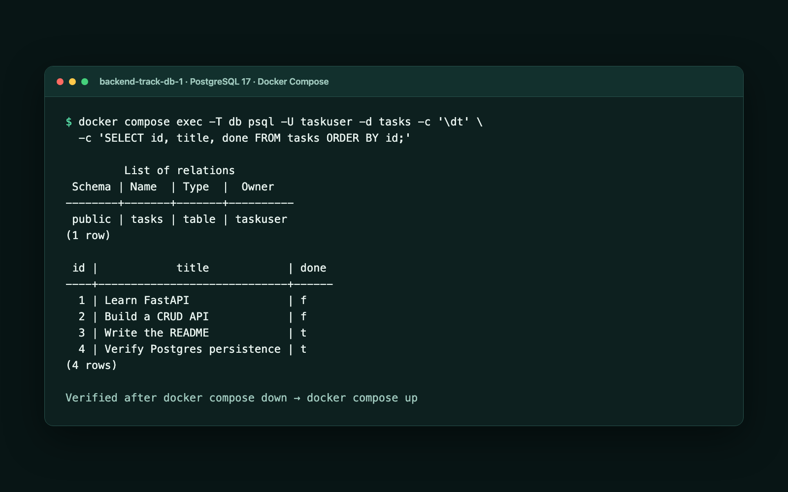

# Task API - Docker and PostgreSQL

A FastAPI CRUD API backed by PostgreSQL. Docker Compose starts the API and
database together, and a named volume keeps tasks across full-stack restarts.

## Quick start

Requirements: Docker Desktop or another Docker-compatible container engine.

From the repository root:

```bash
cp .env.example .env
docker compose up
```

Open:

- API: http://localhost:8000
- Swagger UI: http://localhost:8000/docs
- Database-aware health check: http://localhost:8000/health

The first startup creates the `tasks` table and inserts three example tasks.
Later startups keep the existing rows and do not duplicate the examples.

## How the stack works

Compose runs two services:

- `api` builds the FastAPI application from `awesome-project/Dockerfile`.
- `db` runs the official PostgreSQL 17 image.

The API connects to the hostname `db` inside the Compose network. PostgreSQL
stores its files in the `taskdata` named volume, so removing and recreating the
containers does not remove task data.

Database code is isolated in `awesome-project/repository.py`. Every value from
an API request is passed to Psycopg as a query parameter rather than joined
into SQL text.

## Configuration

Compose reads these values from the ignored `.env` file:

| Variable | Purpose |
|---|---|
| `POSTGRES_DB` | Database created by the Postgres image |
| `POSTGRES_USER` | Local database user |
| `POSTGRES_PASSWORD` | Local database password |
| `DATABASE_URL` | Connection string used by the API |

Start by copying `.env.example`. If you change the example password, update it
in both `POSTGRES_PASSWORD` and `DATABASE_URL`. Never commit `.env`.

## Endpoints

| Method | Path | Purpose | Success |
|---|---|---|---|
| GET | `/` | Describe the API | 200 |
| GET | `/health` | Check the API and database | 200 |
| GET | `/tasks` | List tasks | 200 |
| GET | `/tasks/{task_id}` | Read one task | 200 |
| POST | `/tasks` | Create a task | 201 |
| PUT | `/tasks/{task_id}` | Update title, done, or both | 200 |
| DELETE | `/tasks/{task_id}` | Delete a task | 204 |

List requests support optional filters such as `/tasks?done=true`,
`/tasks?search=milk`, and `/tasks?done=false&search=milk`.

Create body:

```json
{"title": "Buy milk"}
```

Update body:

```json
{"title": "Buy oat milk", "done": true}
```

Titles must be non-empty strings. Updates must supply at least one supported
field, and `done` must be a JSON boolean. Invalid input returns `400`, unknown
task IDs return `404`, and errors use `{"error":"Explanation"}`.

## Verified CRUD cycle

This response was captured from the Compose stack:

```bash
curl -i -X POST http://localhost:8000/tasks \
  -H 'Content-Type: application/json' \
  -d '{"title":"Verify Postgres persistence"}'
```

```http
HTTP/1.1 201 Created
server: uvicorn
content-length: 59
content-type: application/json

{"id":4,"title":"Verify Postgres persistence","done":false}
```

The rest of the same check produced:

| Check | Observed result |
|---|---|
| `PUT /tasks/4` with `{"done":true}` | `200 OK` with `"done":true` |
| Empty-title `POST /tasks` | `400 Bad Request` with a JSON error |
| `GET /tasks/999` | `404 Not Found` with `{"error":"Task not found"}` |
| `DELETE /tasks/4` | `204 No Content` with an empty body |

## Postgres and persistence verification

Inspect the table and its rows directly inside the database container:

```bash
docker compose exec -T db psql -U taskuser -d tasks \
  -c '\dt' \
  -c 'SELECT id, title, done FROM tasks ORDER BY id;'
```



On October 12, 2026, task 4 was created and marked complete. The entire stack
was stopped with `docker compose down` and recreated with `docker compose up`.
`GET /tasks/4` still returned `200 OK` with the same task, and the row was also
visible through `psql`. This confirms that the named volume preserves data.

The generated Swagger UI documents all task routes:


## Stop or reset

Stop and remove the containers while preserving tasks:

```bash
docker compose down
```

To intentionally delete the local database volume and start fresh:

```bash
docker compose down --volumes
```
