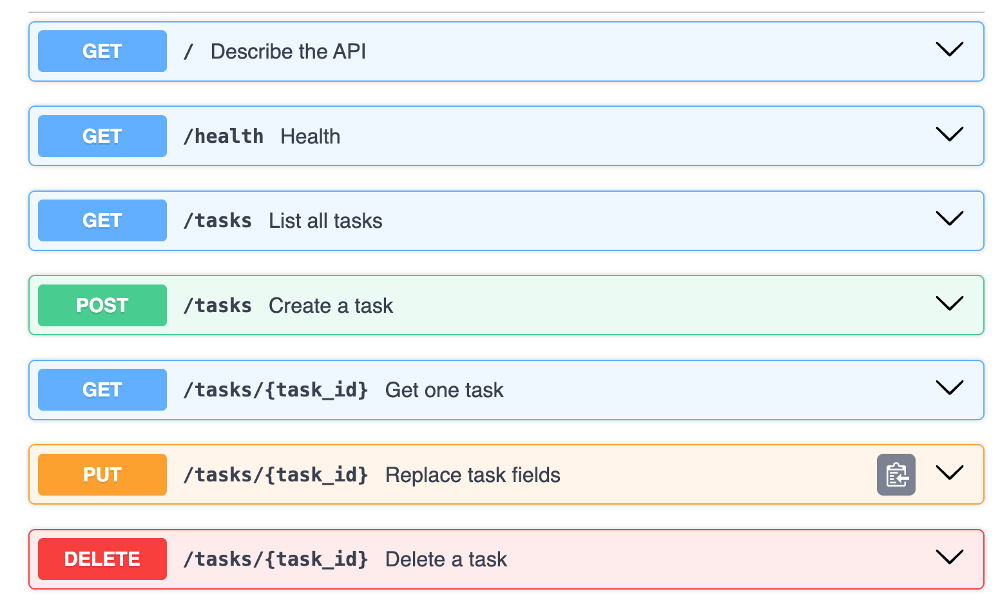
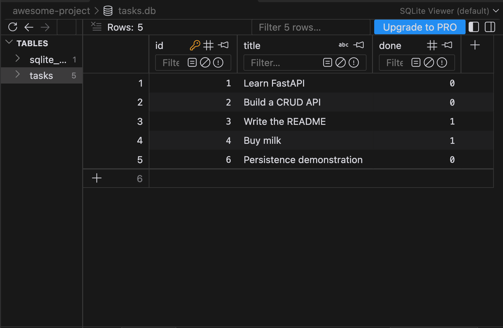

# Task API

A FastAPI application for creating, reading, updating, and deleting tasks.
Tasks are stored in SQLite and survive server restarts.

## Requirements

- Python 3.12 or newer
- uv

## Install and run

From the repository root:

```bash
cd awesome-project
uv sync
uv run fastapi dev main.py
```

Open:

- API: http://localhost:8000
- Swagger UI: http://localhost:8000/docs

The database is created automatically at `awesome-project/tasks.db`.
The application creates the tasks table if missing and inserts three
example tasks whenever the table is empty during startup.

Restarting with existing tasks does not duplicate the examples.
Restarting after deleting every task seeds the examples again.

## Why SQLite?

SQLite stores data in a single file and requires no separate database
server. It keeps tasks available after the application stops or restarts.

The database is ignored by Git so a fresh clone creates its own database.

## Endpoints

| Method | Path | Purpose | Success |
|---|---|---|---|
| GET | `/` | Describe the API | 200 |
| GET | `/health` | Check application health | 200 |
| GET | `/tasks` | List tasks | 200 |
| GET | `/tasks/{task_id}` | Read one task | 200 |
| POST | `/tasks` | Create a task | 201 |
| PUT | `/tasks/{task_id}` | Update title, done, or both | 200 |
| DELETE | `/tasks/{task_id}` | Delete a task | 204 |

List requests support these optional filters:

- `/tasks?done=true`
- `/tasks?search=milk`
- `/tasks?done=false&search=milk`

Create body:

```json
{"title": "Buy milk"}
```

Update body:

```json
{"title": "Buy oat milk", "done": true}
```

Titles must be non-empty strings. Updates must supply at least one
supported field. Explicit null values and unknown fields are rejected.
The done field must be a JSON boolean.

Invalid input returns 400. Unknown task IDs return 404.
Errors use the form `{"error": "Explanation"}`.
Successful deletion returns 204 with an empty body.

## CRUD verification

The following response was captured while creating a task with `curl -i`:

```bash
curl -i -X POST http://localhost:8000/tasks \
  -H 'Content-Type: application/json' \
  -d '{"title":"Verify persistence"}'
```

```http
HTTP/1.1 201 Created
server: uvicorn
content-length: 50
content-type: application/json

{"id":4,"title":"Verify persistence","done":false}
```

The rest of the same CRUD check produced these results:

| Request | Observed result |
|---|---|
| `PUT /tasks/4` with `{"done":true}` | `200 OK`; the response contained `"done":true` |
| `GET /tasks/4` after restarting the server | `200 OK`; task 4 was unchanged |
| `DELETE /tasks/4` | `204 No Content`; the response body was empty |
| `GET /tasks/4` after deletion | `404 Not Found`; `{"error":"Task not found"}` |

## SQL exploration

Example query:

```sql
SELECT id, title, done
FROM tasks
WHERE done = 1;
```

This query selects completed tasks. SQLite stores done as 0 or 1;
the API returns false or true.

During verification, task 4 appeared as `4|Verify persistence|1`. It was
then edited directly with SQL:

```sql
UPDATE tasks
SET title = 'Edited directly with SQL'
WHERE id = 4;
```

The next `GET /tasks/4` returned
`{"id":4,"title":"Edited directly with SQL","done":true}` without a
server restart. This confirms that the API and the SQLite tools read the
same database file.

## Persistence check

On October 12, 2026, task 4 was created and updated, the FastAPI process
was stopped completely, and the application was started again. A new
`GET /tasks/4` returned `200 OK` with the same id, title, and completed
state. The task was then deleted as part of the CRUD verification above.

## Screenshots




